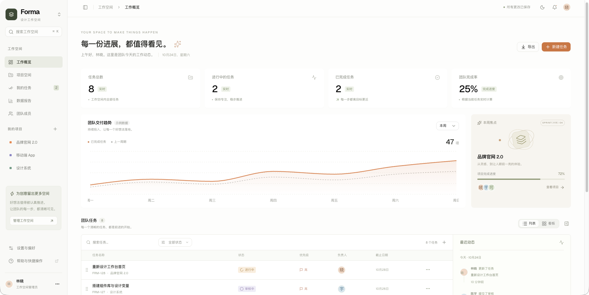

# Forma v0.0.1

可私有部署的轻量项目与任务协作工具。React SPA + PocketBase + SQLite；前端、API、登录和数据存储由一个应用实例提供。



## 本机启动

需要 Node.js 22.12+。原生开发支持 macOS / Linux 的 amd64、arm64。

```sh
cd /Users/dawn/code/forma
npm ci
npm run setup
npm run dev
```

访问 Vite 打印的本地地址（通常为 http://127.0.0.1:5173）。首次打开需输入 `.env` 中的 `FORMA_SETUP_TOKEN`，并自行创建第一个管理员账号。没有默认账号或默认密码；不需要初始化 PocketBase 运维管理员才能使用 Forma。

`npm run setup` 下载固定版本 PocketBase、校验官方 SHA-256，并在缺少 `.env` 时生成随机初始化密钥。已有配置不会被覆盖。首次初始化成功后接口会关闭，即使密钥仍在环境中也不能再次创建首个管理员。

- `npm run dev`：同时运行前端和 PocketBase，Ctrl+C 统一停止。
- `npm run dev:frontend` / `npm run dev:backend`：分别运行。
- `npm run build` 后运行 `npm run dev:backend`：通过 http://127.0.0.1:8090 访问完整应用。
- 本机数据：`backend/pb_data/`。开发程序和运行数据均不会提交到 Git。

## Docker 私有部署

```sh
# 首次部署：生成密钥，已有 .env 时请保留现有配置。
(umask 077; printf 'FORMA_SETUP_TOKEN=%s\nFORMA_BIND=127.0.0.1\nFORMA_PORT=8090\n' "$(openssl rand -hex 32)" > .env)
docker compose up -d --build
```

访问 http://127.0.0.1:8090，使用该 `.env` 中的初始化密钥创建管理员。默认仅绑定本机；局域网部署可将 `FORMA_BIND` 改为指定网卡地址或 `0.0.0.0`。对外访问时在已有 HTTPS 反向代理后部署，前端与 API 保持同源。

应用数据保存在 Compose 的 `forma_data` 命名卷，重建镜像不覆盖数据。镜像支持 linux/amd64、linux/arm64，以 UID 10001 运行。PocketBase 0.40.6 的下载地址和校验值固定在工程中；镜像仅构建阶段需要 Node.js，运行阶段无需 Node、外部数据库、Redis 或云服务。

**当前验收环境没有运行中的 Docker 引擎，Compose 配置已检查，实际镜像构建及容器启动仍需在可用的 Docker 环境中验证。** 原生 PocketBase 的同版本迁移、API、持久化与恢复已集成测试。

## 当前可用能力

- 受部署密钥保护的一次性初始化、邮箱密码登录、退出和登录状态恢复。
- 管理员添加成员、管理角色、停用/启用、重置密码；成员修改自己的密码；密码至少 12 位。
- 项目创建、编辑、归档、恢复；归档项目不接受新任务。
- 任务全部字段编辑：标题、描述、项目、状态、负责人、优先级、0–100% 整数进度、完整截止日期、标签。
- 列表、看板和详情中的百分比可直接修改，Enter 或离开输入框保存、Esc 取消；CSV 包含进度。进度到 100% 自动完成，标记完成同步为 100%；降低已完成任务的进度回到进行中，改回待开始则重置为 0%。
- 列表直接点击状态、优先级、负责人修改；日期按 Enter 或离开输入框保存，Esc 取消。标题旁圆圈一键完成/重新打开，看板卡片可直接修改优先级。
- 设置与偏好支持四档字体大小（100% / 112.5% / 125% / 150%），在当前浏览器保存并即时生效。
- 列表与看板；列表鼠标/键盘排序；看板鼠标跨列移动。
- 我的任务、项目过滤、状态筛选、今天到期、已逾期、关键词搜索、快捷搜索和 CSV 导出。
- 任务移入回收站后可在提示中撤销（8 秒），也可随时到回收站恢复；当前版本不提供永久删除。
- 任务评论、服务端写入的操作动态、真实任务统计和近 7 天完成趋势。
- 实时订阅触发数据刷新，另有焦点刷新和定时补偿；详情面板缩放、窄屏抽屉、深浅主题。
- 帮助与快捷操作页提供三步入门、常用功能入口、快捷键和常见问题，并可下载开发与维护文档；全局搜索输入“帮助”或“新手”即可进入。
- 项目/任务更新携带记录版本；并发修改拒绝旧版本，避免静默覆盖。冲突后保留编辑草稿，并提示重新打开编辑窗口。

## 权限边界

一个部署就是一个共享工作空间。**所有启用成员均能查看、创建和编辑工作空间中的全部项目、任务和评论，并能访问回收站。** 管理员额外管理成员。v0.0.1 不包含私有项目、按项目分组授权、企业 SSO 或多租户隔离。

停用成员后，服务端立即拒绝其业务读写，已有令牌也无法绕过。前端在重新聚焦或最长约一分钟后的身份检查中退出该账号。密码变更后需要重新登录。

Forma 管理员和 PocketBase 运维超级管理员是两个不同的身份。应用前端只使用 `members` 身份，不持有超级管理员密钥。超级管理员仅供服务器维护与备份管理，按 PocketBase 官方文档在服务器侧初始化。

## 检查

```sh
npm run lint
npm run typecheck
npm run build
npm test
```

集成测试创建临时数据目录及独立端口，复制迁移和 Hook 源码，覆盖初始化、关闭注册、角色越权、密码变更、并发写入、评论归属、操作记录、回收站、归档限制、停用令牌、重启持久化和离线备份恢复；结束后清理。不会使用或修改工作空间数据。

`npm run preview:test` 启动独立的临时浏览器验收实例，端口 8091，临时登录信息写入被 Git 忽略的 `test-results/ui-access.json`。该实例及测试账号只用于 UI 验收，Ctrl+C 后删除临时数据；生产镜像不包含此测试脚本。

## 维护与版本范围

PocketBase 的概念、SDK 示例、认证、权限与迁移入门见 [PocketBase 基础用法](docs/pocketbase-basics.md)。

备份、恢复和升级见 [运维说明](docs/operations.md)。v0.0.1 变更见 [版本说明](CHANGELOG.md)。

目前暂不包含附件 UI、@ 提及、未读通知、自动定时备份、任务依赖与重复任务。任务和成员数据按小团队规模全量查询；没有对任意规模数据或并发容量作出保证。

PocketBase 尚未达到 1.0，升级前需核对其变更记录并验证迁移。本项目固定版本，不自动更新后端。
